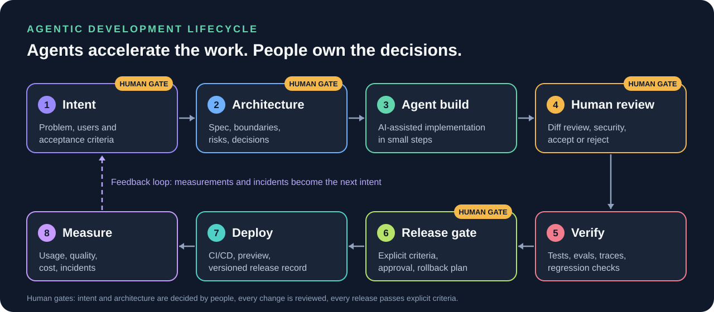

# Agentic SDLC: earned autonomy

A practical framework for building software with AI coding agents while keeping humans accountable for what ships.

> **Status: working framework, v0.1.** It is distilled from building NOVA, ORBIT, FORGE, TrustRail and several healthcare and education prototypes. It has not been validated by an independent study. Metrics are defined in [docs/metrics.md](docs/metrics.md) and marked *not yet measured* until they are.

## The idea

**An agent earns autonomy where automated checks can prove its work, and loses it where they cannot.**

Most teams pick one global setting: review everything, or trust the agent. This framework sets autonomy **per stage and per risk level**, and ties each level to the evidence required to grant it.

Three commitments:

1. **Accountability stays human.** A named person owns intent, architecture and each release decision.
2. **Autonomy is granted by evidence.** More autonomy needs more automated verification, not more optimism.
3. **Every stage leaves an artifact.** If it is not written down, tested or recorded, it did not happen.

## Autonomy levels

| Level | Name | The agent may | A human must | Typical use |
|---|---|---|---|---|
| **L0** | Suggest | Propose options, drafts, plans | Decide and write the change | Architecture, security design, anything irreversible |
| **L1** | Assist | Write code in small steps inside a session | Review every diff before it is kept | New domains, regulated or sensitive data |
| **L2** | Delegate | Complete a scoped task, open a pull request | Review the pull request and pass the gates | Well-tested modules, refactors, UI work |
| **L3** | Supervise | Complete, verify and merge to a non-production branch | Audit samples and approve the release | Low-risk, fully covered, reversible changes |

Rules: autonomy is set per stage, never above **L1** on data or actions you cannot undo, and drops one level after any incident. Details and promotion criteria: [docs/autonomy-levels.md](docs/autonomy-levels.md).

## Stage contracts

Each stage has an entry condition, an exit criterion and a proof. Full table: [docs/stages.md](docs/stages.md).

| # | Stage | Exit criterion | Proof |
|---|---|---|---|
| 1 | Intent | Problem, users, testable acceptance criteria, non-goals | `SPEC.md` |
| 2 | Architecture | Boundaries, data flow, risks, decisions | Decision records |
| 3 | Agent build | Small change against the spec, tests alongside | Pull request |
| 4 | Human review | Diff understood; security and data handling checked | Review checklist |
| 5 | Verify | Tests, evals and regression checks pass | CI and eval report |
| 6 | Release gate | Gate criteria met, limits documented, rollback known | Release record |
| 7 | Deploy | Versioned, reproducible release | Pipeline log |
| 8 | Measure | Usage, quality, cost and incidents recorded | Metrics, post-mortems |

## What is specific to agents

Classic SDLC risks still apply. Agents add their own, listed with controls in [docs/agent-risks.md](docs/agent-risks.md): scope drift, tests written to pass, invented dependencies, leaked secrets, runaway cost, unreviewed volume, and context rot.

## Case studies

- **[TrustRail](docs/case-studies/trustrail.md)** (draft): eight defects that passed the tests and were found only by running the real stack, and the process changes that followed.

## Templates

Copy these into a project: [`SPEC.md`](templates/SPEC.md) · [`AGENTS.md`](templates/AGENTS.md) · [`DECISION.md`](templates/DECISION.md) · [`REVIEW-CHECKLIST.md`](templates/REVIEW-CHECKLIST.md) · [`RELEASE.md`](templates/RELEASE.md)

## Adopting it in a week

1. Pick one project and write its `SPEC.md` and `AGENTS.md`.
2. Set a starting level per stage (default **L1**).
3. Add the review checklist to your pull request template.
4. Define the release gate and record the first release.
5. After two weeks, measure with [docs/metrics.md](docs/metrics.md) and promote or demote a stage.

## How my own tools map to it

| Tool | Role in the lifecycle |
|---|---|
| [NOVA](https://github.com/yassineaqejjaj/NOVA) | Orchestrates plans, approvals and deliverables (stages 1 to 4) |
| [ORBIT](https://github.com/yassineaqejjaj/ORBIT) | Supplies governed, cited, permission-aware context |
| [FORGE](https://github.com/yassineaqejjaj/FORGE) | Evaluates and compares agent behavior (stage 5 and 6) |
| [TrustRail](https://github.com/yassineaqejjaj/TrustRail) | Controls what agents may do and records receipts |

## Limits of this framework

- Levels and thresholds are judgment calls, not standards. Adjust them to your risk.
- It targets small teams and solo builders first. Large organizations will need roles and audit layers on top.
- It says little about model selection or prompt design; those change too fast to freeze here.

## Contributing

Issues and pull requests welcome, especially field reports of where a level or gate failed. MIT licensed.
